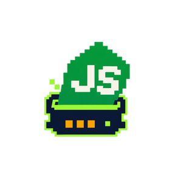

<p align="center">
  
</p>

<h1 align="center">thinpack.js</h1>

<p align="center">把 Node.js 程序打包成单个可执行文件。用户运行时无需另外安装 Node.js、Bun 或 npm。</p>

<p align="center"><a href="README.md">English</a> | <b>简体中文</b></p>

[](https://github.com/thinpack-js/thinpack.js/actions/workflows/ci.yml)

## 快速开始

macOS 或 Linux 用户可以在新建的目录里执行：

```sh
curl -fsSL https://raw.githubusercontent.com/thinpack-js/thinpack.js/main/scripts/install.sh | sh
printf '%s\n' 'console.log("Hello from Thinpack!")' > hello.js
"$HOME/.local/bin/thinpack" pack hello.js -o hello
./hello
```

Windows x64 用户，请下载并解压[对应的发布包](https://github.com/thinpack-js/thinpack.js/releases/latest)，然后在解压目录中运行：

```powershell
'console.log("Hello from Thinpack!")' | Set-Content -Encoding Ascii hello.js
.\thinpack.exe pack hello.js -o hello.exe
.\hello.exe
```

两种方式都会输出 `Hello from Thinpack!`。把 `hello.js` 换成你的程序入口，按目标系统和 CPU 架构打包。打包机器上保留 `thinpack` 和运行时模板，发给用户的只需是生成的可执行文件。

## 体积与兼容性

一行 `console.log("hello")` 在 [Linux x64 CI](https://github.com/thinpack-js/thinpack.js/actions/runs/45674940548) 上用 QuickJS 和 `--rebuild` 打包后为 **5.36 MiB**（5,615,289 字节）。这是包含运行时的独立可执行文件。

在 [Linux x64 基准测试](docs/benchmarks.md)中，同一个 `tsc` 用 Thinpack 打包后为 **9.0 MiB**，用 Bun `--compile` 打包后为 **109.6 MiB**。Thinpack 使用 QuickJS，配合 `--rebuild` 只链接所需的内置模块。直接使用预构建模板，产物会更大；QuickJS 也可能用较慢的启动速度换取更小的体积。

Thinpack 支持许多 Node.js API，但不能完全替代 Node.js，也不能加载 Node 原生扩展。额外资源文件或运行时才确定路径的本地导入，可以用 `--include <path>` 加入包内，路径相对于项目根目录。分发前，请在每个目标平台上验证常用命令。

- [下载、引擎选项与命令行参数（英文）](docs/reference.md)
- [Node.js 兼容性限制（英文）](docs/reference.md#known-limits)
- [基准测试与测量方法（英文）](docs/benchmarks.md)
- [MIT 许可证](LICENSE)
